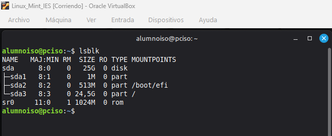
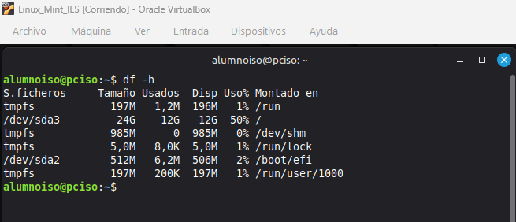
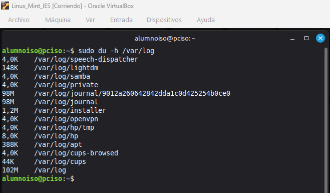
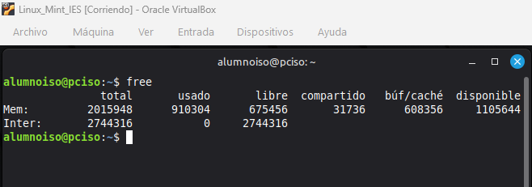
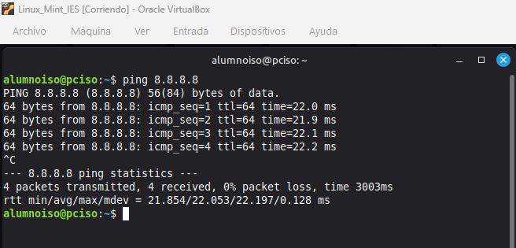

# Comandos Básicos en Linux para Administradores de Sistemas


Actualmente en los entornos Linux prácticamente se puede administrar por completo mediante la herramienta gráfica y no solo desde consola como anteriormente. Pese a esto, conviene no olvidar el uso de los comandos más utilizados en estos entornos para realizar la administración de una manera más rápida y eficiente.

En esta guía haremos un repaso sobre los distintos comandos de uso básico por parte de los Administrados de Sistemas Informáticos en **Linux** agrupados por categorías.

Indicar que en gran parte de los comandos que veremos a continuación, se deben de ejecutar con **sudo**, por lo que conviene estar seguros de que queremos ejecutar y en que situación.

Para más información, se puede consultar la guía oficial de Linux en el siguiente [enlace](https://ubuntu.com/tutorials/command-line-for-beginners).

---

## Indice


- [Comandos Básicos en Linux para Administradores de Sistemas](#comandos-básicos-en-linux-para-administradores-de-sistemas)
  - [Indice](#indice)
    - [1. Gestión de Archivos](#1-gestión-de-archivos)
      - [1.1 Revisión y Modificación de Archivos y/o Directorios](#11-revisión-y-modificación-de-archivos-yo-directorios)
      - [1.2 Visualización y modificación de archivos](#12-visualización-y-modificación-de-archivos)
      - [1.3 Gestión de Permisos en Archivos y Directorios](#13-gestión-de-permisos-en-archivos-y-directorios)
    - [2. Gestión de Usuarios](#2-gestión-de-usuarios)
      - [2.1 Consulta de Usuarios y Grupos](#21-consulta-de-usuarios-y-grupos)
      - [2.2 Administración de Usuarios y Grupos](#22-administración-de-usuarios-y-grupos)
    - [3. Gestión de Procesos](#3-gestión-de-procesos)
    - [4. Gestión de Servicios](#4-gestión-de-servicios)
    - [5. Gestión del Almacenamiento](#5-gestión-del-almacenamiento)
    - [6. Gestión de Red](#6-gestión-de-red)
    - [7. Gestión de Paquetes](#7-gestión-de-paquetes)
  

---

### 1. Gestión de Archivos

Una parte importante de Administrar sistemas informáticos pasa por gestionar y supervisar el sistema de archivos en un equipo, así como establecer los permisos necesarios sobre estos.

A continuación, veremos los comandos más utilizados en este sentido con algún ejemplo de ejecución.

#### 1.1 Revisión y Modificación de Archivos y/o Directorios

Para poder revisar y modificar algún fichero podemos usar los siguientes comandos:
| Comando | Explicación breve | Ejemplo de uso
|:------------------------:|:------------------------:|:------------------------:|
pwd | Muestra el directorio actual sobre el que estemos trabajando | pwd
ls "ruta" | Listar archivos de una ruta | ls -lh
cd "ruta" | Cambiar de directorio | cd /var/log
mkdir "ruta" | Crear directorios | mkdir -p /opt/app/data
cp "ruta" | Copia archivos | cp archivo.conf backup/
mv "ruta" | Mueve/renombra | mv old.conf new.conf
rm "ruta" | Eliminar archivos| rm archivo.tmp
rmdir "ruta" | Eliminar directorio| rm /opt/app/data
find "ruta" | Buscar archivos | find /var -name "*.log"
file | Identifica el tipo de archivo | file backup.tar

> El comando **rm -rf** no debe utilizarse ya que elimina los directorios y su contenido de la ruta que indiquemos sin pedir confirmación.

#### 1.2 Visualización y modificación de archivos

Una vez que tenemos en orden los comandos para gestionar los archivos y directorios, pasaremos a ver los comandos para poder visualizar y modificar archivos.

| Comando | Explicación breve | Ejemplo de uso
|:------------------------:|:------------------------:|:------------------------:|
cat "ruta" | Visualizar archivo de una ruta | cat /etc/hostname
less "ruta" | Leer el contenido de un archivo de texto línea a línea | less /var/log/syslog
head "ruta" | Muestra las primeras líneas de un archivo | head -n 20 archivo.log
tail "ruta" | Muestra las últimas líneas de un archivo | tail -f /var/log/app.log
nano "ruta" | Creamos archivo en la ruta que le pasemos | nano /etc/hosts
grep "parámetro" "ruta" | Buscamos el parámetro que indiquemos en la ruta insertada en el comando | grep "ERROR" /var/log/app.log

#### 1.3 Gestión de Permisos en Archivos y Directorios

En los sistemas Linux, se establecen permisos a nivel de usuarios,grupos, etc.
Dos de los comandos más típicos para la gestión de permisos son "chmod" y "chown".

> chmod: Utilizado para cambiar los permisos de archivos y directorios.
> chown: Utilizado para cambiar el propietario o grupo propetiario de un archivo y/o directorio.

Ejemplos:

```bash
chmod 640 miarchivo
chown -R www-data:www-data /var/www/app
```

Los permisos más habituales a establecer son los siguientes:

- **664** - Permisos para archivos normales.
- **775** - Permisos para ejecutables y/o directorios públicos.
- **600** - Permisos para archivos privados.
- **700** - Permisos para directorios privados.

---

### 2. Gestión de Usuarios

Como Administradores de Sistemas, también debemos gestionar los usuarios y grupos de usuarios que van a trabajar en nuestros equipos ya bien sean usuarios locales o usuarios por LDAP.
Primeramente veremos como se consultan los usuarios y los grupos, y posteriormente veremos como se gestionan.

#### 2.1 Consulta de Usuarios y Grupos

En un Sistema Operativo utilizado tanto a nivel personal como sobretodo a nivel profesional, se debe crear y gestionar como mínimo un usuario que accederá a los recursos y funciones de dicho Sistema Operativo.

A continuación veremos algunos de los comandos más utilizados para consultar los usuarios y grupos de usuarios en Linux:

| Comando | Explicación breve |
|:------------------------:|:------------------------:|
| whoami | Muestra el nombre de usuario con el que se inició sesión | 
|id usuario | Muestra la información de identidad del usuario que indiquemos | 
| who | Muestra los usuarios que iniciaron sesión en el sistema en ese momento | 
| w | Muestra que usuarios están conectados actualmente y que procesos se están ejecutando | 

#### 2.2 Administración de Usuarios y Grupos

Con respecto a nuestra labor como Administradores de Sistemas, nuestra labor pasará por crear y/o gestionar usuarios así como grupos de usuarios. Para ello, debemos de apoyarnos de los siguientes comandos:

| Comando | Explicación breve | Ejemplo |
|:------------------------:|:------------------------:|:------------------------:|
| useradd | Crear una nueva cuenta de usuario | useradd -m pablo|
| passwsd | Crear o modificar la contraseña de una cuenta | passwd pablo|
| usermod | Modoficar los datos de una cuenta de usuario existente | usermod -aG sudo pablo |
| userdel | Eliminar cuenta de usuario | userdel -r pablo |
| groupadd | Crear un nuevo grupo de usuarios | groupadd sistemas |
| groups | Mostrar los grupos a los quere pertenece un usuario | groups pablo |

> Importante: En distribuciones como Debian y/o Ubuntu, tendremos a mayores las alternativas adduser y deluser para crear y eliminar usuarios respectivamente.

---

### 3. Gestión de Procesos

En todo Sistema Operativo se inician, ejecutan y terminan distintos procesos con el que se consiguen diferentes funcionalidades.

Una tarea común al gestionar S.O. puede ser la de buscar y cambiar el estado de un proceso, llegando a finalizarlo para evitar problemas de sobrecarga de los recursos del sistema.

En este aspecto podemos comentar tres comandos de gran utilidad:

- **Top:** Este comando monitorea el rendimiento del sistema y los procesos que están activos en tiempo real.  
- **Ps aux:** Este comando muestra una lista detallada de todos los procesos que se están ejecutando en el sistema en el momento que se lanza. Se puede filtrar la salida de este comando a través de una tubería y el comando *grep*. Ejemplo: `ps aux | grep nginx` -> filtra entre todos los procesos para devolver los detalles del proceso **nginx**.
- **Kill:** Este comando se utiliza para enviar señales a los procesos (el más común para cerrar o terminarlos.) Para ello tendremos que saber el **PID** del proceso a gestionar que podremos obtenerlo a través del comando *ps aux* como vimos anteriormente. Ejemplo: `kill -9 1234`.

---

### 4. Gestión de Servicios

Al igual que con los procesos, debemos gestionar los servicios de un Sistema Operativo para iniciarlos o detenerlos en caso de que sea necesario.

El comando que utilizaremos a la hora de gestionar los distintos servicios será el comando **systemctl**. 

Los estados que utilizaremos a la hora de ejecutar el anterior comando serán:

- **status**: Para poder revisar el estado en el que se encuentra un servicio. Ejemplo: `systemctl status nginx`.
- **start**: Para iniciar un servicio. Ejemplo: `systemctl start nginx`.
- **stop**: Para detener un servicio. Ejemplo: `systemctl stop nginx`.
- **restart**: Para reiniciar un servicio. Ejemplo: `systemctl restart nginx`.
- **enable**: Para hacer que un servicio arranque automáticamente al iniciar el Sistema Operativo. Ejemplo: `systemctl enable nginx`.
- **disable**: Para hacer que un servicio deje de arrancarse automáticamente al iniciar el Sistema Operativo. Ejemplo: `systemctl disable nginx`.

A mayores, es interesante utilizar el comando **journalctl**, que nos permitirá ver los logs de un servicio en concreto para poder encontrar errores por ejemplo. Ejemplo de uso: `journalctl -u nginx`.

---

### 5. Gestión del Almacenamiento

La otra parte primordial de un Sistema Operativo es el almacenamiento. Una buena gestión del almacenamiento disponible en un aspecto primordial para el uso eficiente de un Sistema Operativo.

Para ello, podemos ver los discos o volúmenes existentes en el equipo con el comando **lsblk**. Al lanzarlo, nos devolverá el listado de unidades y volúmentes en forma de árbol.



Una vez que tengamos esta información, podremos revisar el espacio disponible con el comando **df**. Ejemplo de uso: `df -h`.



También podremos revisar el peso de un fichero, carpeta o unidad con el comando **du**, seguido de la ruta que queramos revisar. Ejemplo de uso: `du -h /var/log`.



Por último, pero no por ello menos importante, podremos revisar la cantidad de memoria RAM libre y la utilizada por el sistema con el comando **free**. Ejemplo de uso: `free -h`.



---

### 6. Gestión de Red

En Linux, las configuraciones de red se realizan modificando varios archivos de configuración por ejemplo el fichero interfaces de la ruta `/etc/network`.

Sin embargo, si debemos de tener en cuenta varios comandos para comprobar la conectividad de nuestros equipos.

Al igual que en los entornos Windows, el comando más básico es **ping**. Con este comando podemos verificar la conectividad entre dos equipos. Ejemplo de uso: `ping 8.8.8.8`.



Otro comando típico es **traceroute**. Con este comando podemos ver por que equipos pasa nuestra petición hacia el destino. Ejemplo de uso: `traceroute 8.8.8.8`.

> Indicar que en los comandos indicados, a mayores de poder lanzarlos indicando la IP del destino, podemos lanzarlos indicando el hostname del destino en caso de saberlo.

---

### 7. Gestión de Paquetes

Por último, pero también primordial, tendremos que tener los equipos correctamente actualizados.

Para ello, utilizaremos el comando **apt** en sus variantes:

* `apt update: Para actualizar el sistema.`
* `apt upgrade: Para poder instalar las actualizaciones.`

A mayores, para instalar o desinstalar cualquier programa en nuestros equipos Linux, debemos utilizar los comandos:

* `apt install: Para instalar programas.`
* `apt remove: Para desinstalar programas.`

---
